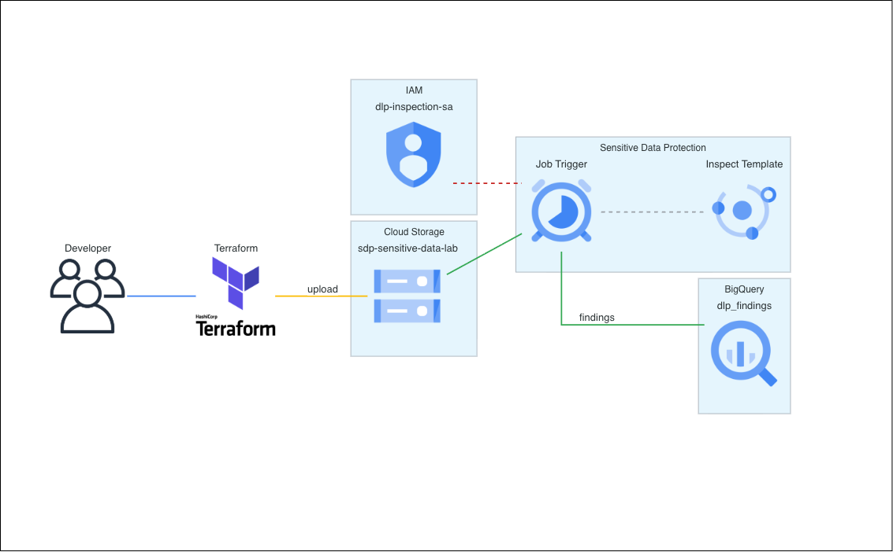

# GCP Sensitive Data Protection Lab

Terraform foundation for a Google Cloud Sensitive Data Protection (Cloud DLP) experiment. Inspects CSV files stored in Cloud Storage for PII and writes findings — including exact matched values — to BigQuery.

## Architecture



> **Flow:** Developer runs `terraform apply` → CSV files uploaded to Cloud Storage → DLP Job Trigger scans the bucket daily using the Inspect Template → findings saved to BigQuery with exact matched values.

## What this deploys

| Resource | File | Purpose |
|---|---|---|
| Cloud Storage bucket | `storage.tf` | Private bucket for sample CSV files |
| DLP Inspect Template | `dlp.tf` | Defines infoTypes: CPF, email, phone, name, DOB |
| DLP Job Trigger | `dlp.tf` | Scans the bucket daily, saves findings with `include_quote=true` |
| BigQuery dataset | `bigquery.tf` | Stores inspection findings including exact matched values |
| Service account | `iam.tf` | Least-privilege identity for all DLP operations |
| GCP APIs | `apis.tf` | DLP, Storage, IAM, BigQuery, Cloud Resource Manager |
| Sample CSV files | `uploads.tf` | `clientes.csv`, `funcionarios.csv`, `leads.csv` uploaded on apply |

## Project structure

```
├── versions.tf              # Terraform ≥ 1.5 and Google provider ~> 5.0
├── provider.tf              # Google Cloud provider + quota project
├── variables.tf             # project_id, region, bucket_name, environment
├── apis.tf                  # GCP API enablement
├── storage.tf               # Private Cloud Storage bucket
├── iam.tf                   # Service account and IAM bindings
├── bigquery.tf              # BigQuery dataset and permissions
├── dlp.tf                   # Inspect template and job trigger
├── uploads.tf               # Sample CSV uploads via terraform apply
├── outputs.tf               # Bucket URL, SA email, BigQuery table path
├── terraform.tfvars.example # Variable template — copy to terraform.tfvars
├── samples/                 # Sample PII CSV files (gitignored)
└── arch.png                 # Architecture diagram
```

## Prerequisites

| Tool | Minimum version |
|---|---|
| Terraform | 1.5 |
| Google Cloud SDK | any recent |

### Authentication

```bash
gcloud auth application-default login
```

Your account needs these roles on the target project:

- `roles/serviceusage.serviceUsageAdmin`
- `roles/storage.admin`
- `roles/iam.serviceAccountAdmin`
- `roles/resourcemanager.projectIamAdmin`
- `roles/bigquery.admin`

## Configuration

```bash
cp terraform.tfvars.example terraform.tfvars
```

```hcl
project_id  = "your-gcp-project-id"
region      = "us-central1"
bucket_name = "sdp-sensitive-data-lab"
environment = "lab"
```

## Deployment

```bash
# Download the Google provider plugin
terraform init

# Check syntax and configuration
terraform validate

# Preview what will be created
terraform plan

# Create all resources and upload sample files
terraform apply

# Tear everything down
terraform destroy
```

After `terraform apply`:

```
bucket_name           = "sdp-sensitive-data-lab"
bucket_url            = "gs://sdp-sensitive-data-lab"
service_account_email = "dlp-inspection-sa@your-project.iam.gserviceaccount.com"
bigquery_dataset      = "dlp_findings"
findings_table        = "your-project.dlp_findings.results"
```

## Querying findings

After the first DLP scan runs, query results in BigQuery:

```sql
SELECT
  location.content_locations[0].record_location.field_id.name AS column,
  info_type.name                                               AS pii_type,
  likelihood,
  quote                                                        AS exact_value
FROM `your-project.dlp_findings.results`
ORDER BY likelihood DESC
```

## Security

- Bucket is private — uniform access, public access prevention enforced
- No service account keys created
- IAM follows least privilege — no Owner, Editor, or broad roles
- `terraform.tfvars`, `*.tfstate`, and `samples/` are gitignored

## Estimated cost

| Component | Cost |
|---|---|
| Cloud Storage (standard, regional) | ~$0.02 / GB / month |
| Sensitive Data Protection — first 50,000 units/month | Free |
| BigQuery — first 10 GB storage / 1 TB queries per month | Free |

Total for lab use: **effectively $0**.

## Notes

- **API propagation** — newly enabled APIs can take 60–120 s to become active after `terraform apply`. Re-run if the first apply fails on DLP resources.
- **Quota project** — `provider.tf` sets `user_project_override = true` so ADC user credentials bill against your project, not Google's default.
- **Bucket name uniqueness** — GCS bucket names are globally unique. Change `bucket_name` if `terraform apply` returns a 409 conflict.
- **Local state** — `terraform.tfstate` is stored locally. For team use, migrate to a remote GCS backend.
